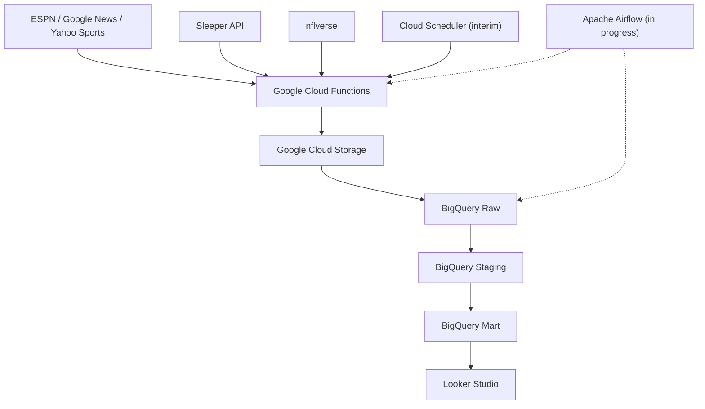
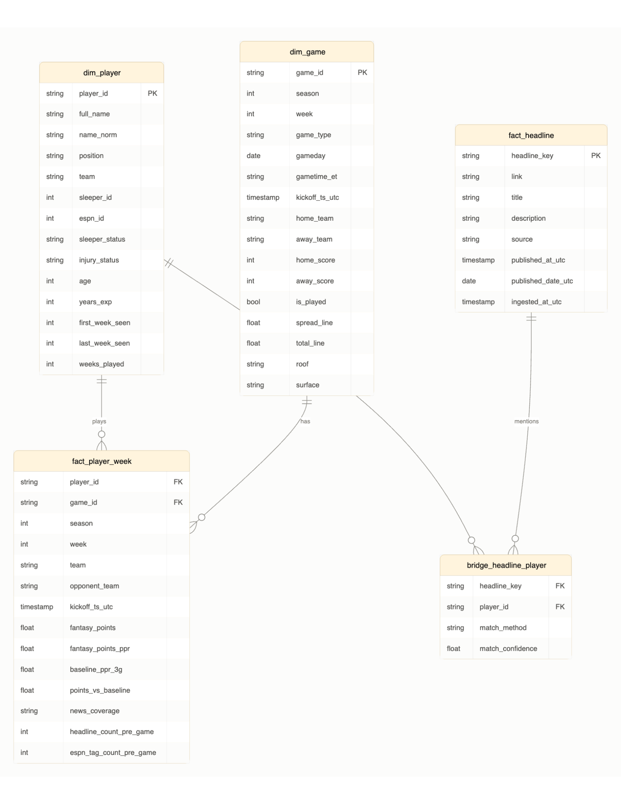

# NFL Fantasy News Pipeline (BA882)

## Project Overview

This project is developed as part of BA882: Deploying Analytics Pipelines at Boston University Questrom School of Business.

Our goal is to build an automated cloud-based analytics pipeline that integrates NFL news, player information, and weekly performance statistics into a centralized data warehouse.

The pipeline is designed to support exploratory analysis of the relationship between pregame news coverage and subsequent fantasy football performance, while establishing a foundation for future machine learning and NLP applications.

## Business Problem

NFL fantasy football performance is influenced by multiple factors, including player injuries, roster changes, team developments, and recent performance trends.

However, relevant information is distributed across different news providers and statistical databases. This fragmentation makes it difficult to systematically analyze whether news activity is associated with future player performance.

Our project addresses this challenge by creating an integrated and continuously updated analytics infrastructure.

The primary research question is:

**To what extent is pregame NFL news coverage associated with subsequent fantasy football performance, and can news-derived features improve predictive models?**

## Data Sources

Our pipeline integrates several NFL data sources:

| Source | Data Collected | Collection Schedule |
|---|---|---|
| ESPN | NFL headlines, descriptions, publication times, and athlete tags | Daily |
| Google News | Headlines from four topic-based searches: NFL news, injuries, fantasy football, and roster changes | Daily |
| Yahoo Sports | NFL news headlines and publication times | Daily |
| Sleeper API | Player profiles, positions, teams, and injury status | Tuesday and Saturday |
| nflverse | Weekly player statistics and NFL schedules | Weekly Tuesday (Airflow integration planned) |

The ingestion process uses Python-based Google Cloud Functions to extract data and store raw records as newline-delimited JSON (NDJSON) in Google Cloud Storage.

Google News ingestion was updated from 32 team-specific searches to four broader searches after the original approach encountered blocked requests.

## Technology Stack

| Component | Technology |
|---|---|
| Cloud Platform | Google Cloud Platform (GCP) |
| Data Ingestion | Python, Google Cloud Functions |
| Raw Data Storage | Google Cloud Storage (GCS) |
| Scheduling | Google Cloud Scheduler (interim) |
| Pipeline Orchestration | Apache Airflow / Astronomer (in progress) |
| Data Warehouse | Google BigQuery |
| Data Transformation | BigQuery SQL |
| Data Visualization | Looker Studio |
| Version Control | GitHub |
| Project Management | GitHub Projects |

**Google Cloud Configuration**

- Project ID: `ba882-team03-kalshi`
- Region: `us-central1`
- GCS Bucket: `ba882-nfl-kalshi-raw`
- Cloud Function: `nfl-ingest`

## Pipeline Architecture

Our project follows an ELT-oriented architecture, separating data ingestion, raw storage, transformations, and reporting.



### Data Ingestion

The `nfl-ingest` Cloud Function supports three ingestion jobs:

- `news`: Collects NFL headlines from ESPN, Google News, and Yahoo Sports.
- `players`: Retrieves player information from the Sleeper API.
- `stats`: Retrieves NFL player statistics and schedules using nflverse.

Raw data is stored in GCS using source- and date-based paths.

Example directory structure:

```text
gs://ba882-nfl-kalshi-raw/
├── news/
│   ├── espn/
│   ├── google/
│   └── yahoo/
├── players/
│   └── sleeper/
└── stats/
    ├── player_week/
    └── schedule/
```

Cloud Scheduler provides interim scheduling for news and player ingestion.

Apache Airflow is being integrated to orchestrate extraction, data loading, transformations, and data quality checks.

**Current limitation:** Loading raw data from GCS into BigQuery has not yet been automated through Airflow. The warehouse's initial raw data was loaded manually.

## BigQuery Data Warehouse

Our data warehouse is implemented in Google BigQuery using three datasets:

### 1. Raw Layer

Stores source data from ESPN, Google News, Yahoo Sports, Sleeper, and nflverse.

### 2. Staging Layer

Five staging models clean and standardize the raw data. Transformations include:

- Removing duplicate news headlines.
- Standardizing timestamps.
- Normalizing player names.
- Reconciling player identities across sources.
- Preparing player statistics and NFL schedules.

### 3. Mart Layer

Five analytical tables support reporting and future predictive modeling.

| Table | Description |
|---|---|
| `dim_player` | Player profiles, positions, teams, and injury information |
| `dim_game` | NFL game schedules and kickoff times |
| `fact_headline` | Deduplicated NFL news headlines |
| `bridge_headline_player` | Links headlines to players with matching methods and confidence scores |
| `fact_player_week` | Weekly fantasy performance, historical baselines, and pregame headline counts |

### Entity Relationship Diagram



### Initial Data Snapshot

The initial warehouse build reported:

| Metric | Value |
|---|---:|
| Players | 512 |
| NFL Games | 272 |
| Unique Headlines | 846 |
| Headlines Matched to Players | Approximately 39% |
| Player Matching via Normalized Name + Team | 493 of 512 (~96%) |

These figures represent an initial snapshot, not continuously updated totals.

Cross-source player identification remains a challenge. Matching uses standardized player names and teams when reliable identifiers are unavailable. Headline matching prioritizes ESPN athlete tags, followed by name-based matching.

## SQL Transformations

SQL transformations are organized into two directories:

- [`sql/staging/`](sql/staging/) — Data cleaning and standardization.
- [`sql/mart/`](sql/mart/) — Analytical tables.

**Execution order:**

1. Load source files from GCS into BigQuery `raw` tables.
2. Run `sql/staging/00_norm_name.sql` to create the shared name-normalization function.
3. Run staging SQL models `01` through `05` in numeric order.
4. Run mart SQL models `01` through `05` in numeric order.
5. Validate table outputs and data freshness.

The models use `CREATE OR REPLACE` statements to support repeatable builds without accumulating duplicate transformed rows.

For nflverse statistics and schedules, the raw load should use the latest full-season snapshot instead of appending all historical snapshots.

**Note:** The current staging `02` SQL filename contains leading spaces. This must be accounted for when automating execution.

## Phase 1 Reporting and Analysis

Our initial reporting layer includes a Looker Studio dashboard and three BigQuery analytical queries.

### Looker Studio Dashboard

[View Phase 1 Looker Studio Dashboard](https://datastudio.google.com/u/0/reporting/70217ab0-fbb8-4f78-ae76-9bb69a1001a3/page/hKqBG/edit)

The dashboard presents:

- NFL headline volume by source.
- Player news coverage and headline matching.
- Latest news ingestion time.
- Historical fantasy football performance.

Dashboard access depends on the report's sharing permissions.

### Analytical SQL Queries

The [`sql/analysis/`](sql/analysis/) directory contains:

1. **Source Match Rate:** Analyzes the percentage of headlines successfully linked to players by source.
2. **Top Players by Headlines:** Identifies players with the highest number of matched headlines.
3. **Week 6 PPR vs. Baseline:** Compares Week 6 PPR fantasy points with each player's previous three-game average.

The initial news reporting queries use an October 19–21, 2026 UTC snapshot.

These queries have been committed to GitHub; their successful execution against the live warehouse still requires verification.

## Phase 1 Scope and Limitations

News collection began on October 19, 2026, while the initial historical player statistics cover NFL Weeks 1–6.

As a result, the available dataset does not yet contain sufficient complete pregame news windows to reliably evaluate the relationship between headline volume and subsequent fantasy performance.

The `fact_player_week` table includes a `news_coverage` field that distinguishes:

- `none`: No available pregame news coverage.
- `partial`: Incomplete pregame news coverage.
- `full`: The seven-day pregame window is covered by the available news collection period.

Missing historical news coverage is not treated as zero headlines.

Phase 1 therefore focuses on demonstrating data ingestion, warehouse modeling, headline coverage, and descriptive reporting rather than establishing predictive relationships.

As additional weekly statistics and news observations become available, the pipeline will support more comprehensive analysis.

## Development Practices

We use GitHub for version control and project coordination.

Our workflow includes:

- Feature branches for individual development tasks.
- Pull requests for reviewing and merging changes.
- A protected `main` branch requiring peer approval.
- GitHub Issues and a shared Project Board for tracking responsibilities and deliverables.

### Project Resources

- [GitHub Repository](https://github.com/Aa0414/nfl-fantasy-pipeline)
- [GitHub Project Board](https://github.com/users/Aa0414/projects/1)
- [Entity Relationship Diagram](docs/erd.png)
- [Looker Studio Dashboard](https://datastudio.google.com/u/0/reporting/70217ab0-fbb8-4f78-ae76-9bb69a1001a3/page/hKqBG/edit)

## Looking Ahead

In future phases, we plan to incorporate machine learning and natural language processing (NLP) into the pipeline.

Using historical player statistics and pregame news signals, we aim to predict weekly fantasy football performance and evaluate whether news-related features improve predictive accuracy.

We also plan to use NLP and generative AI to classify headlines into categories such as injuries, trades, and roster changes.

These enhancements will help transform the existing data infrastructure into a more comprehensive NFL fantasy analytics platform.
